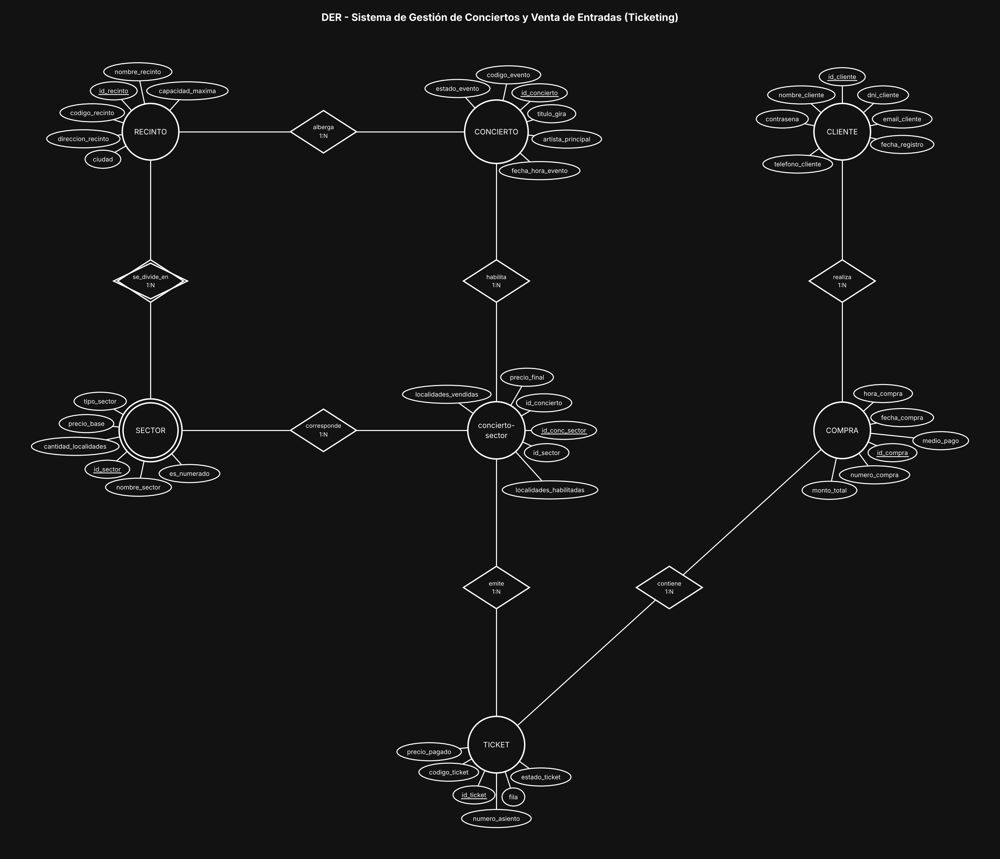

# BaseDeDatos-U2-Ej11-VentaEntradas

Base de Datos - Unidad 2 - Ejercicio 11

## Consigna

Modelar el sistema de una productora de espectáculos: recintos divididos en sectores, conciertos programados en esos recintos, clientes registrados, y la venta online de entradas mediante órdenes de compra que agrupan uno o más tickets con trazabilidad de la ubicación.

## Lógica

**SECTOR como entidad débil de RECINTO.** "Platea Baja" o "Campo delantero" son nombres que se repiten en todos los recintos: no identifican nada por sí solos. Su PK es `id_sector` y la identidad lógica es `id_recinto` + `nombre_sector` (UNIQUE compuesto); además la relación `se_divide_en` es identificatoria, por eso van con círculo y rombo doble. Es una composición: si se da de baja el recinto, sus sectores no tienen sentido.

**CONCIERTO N:1 RECINTO.** El enunciado lo dice explícito: un recinto alberga muchos conciertos a lo largo del tiempo, pero un concierto ocurre en un único recinto. No hace falta N:M.

**`concierto-sector` es la clave del punto 3 (disponibilidad).** La capacidad de un sector es un dato fijo del recinto, pero la disponibilidad es por evento: el mismo sector puede habilitarse entero en un show, parcialmente en otro, o no usarse. Por eso la intermedia guarda `localidades_habilitadas`, `localidades_vendidas` y `precio_final`. El precio también va acá y no se lee de `precio_base`: el precio base es el de referencia del sector, mientras que el de un show puntual cambia según el artista y la demanda.

**TICKET cuelga de `concierto-sector`, no de CONCIERTO y SECTOR por separado.** Si el ticket tuviera FK a concierto y a sector cada una por su lado, se podría emitir un ticket para una combinación que no existe (un sector que no se habilitó para ese show). Apuntando a la fila de disponibilidad, la combinación válida está garantizada por diseño y además no se duplica información: es la forma de evitar la redundancia que pide la unidad.

**COMPRA separada de TICKET (1:N).** La compra es la transacción (fecha, hora, monto total, medio de pago) y el ticket es la unidad física con su ubicación. Una compra agrupa uno o más tickets, que es exactamente lo que pide el enunciado. Meter todo en una sola entidad obligaría a repetir los datos de la transacción en cada entrada y rompería la atomicidad del monto total.

**El cliente comprador llega al ticket por la compra.** No se puso una relación directa CLIENTE–TICKET: sería redundante y podría contradecir al comprador de la orden. El enunciado pide trazabilidad, y con `TICKET → COMPRA → CLIENTE` la trazabilidad está completa.

**Cardinalidades del circuito de venta:** CLIENTE 1:N COMPRA, COMPRA 1:N TICKET (participación total: una compra sin tickets no existe), `concierto-sector` 1:N TICKET.

**Restricciones de integridad a considerar:** la suma de `localidades_habilitadas` de todos los sectores de un concierto no puede superar la `capacidad_maxima` del recinto; `localidades_vendidas` nunca puede superar a las habilitadas; en sectores numerados, la combinación `id_conc_sector` + `fila` + `numero_asiento` debe ser única para que no se venda dos veces la misma butaca; y el `monto_total` de la compra tiene que coincidir con la suma de los `precio_pagado` de sus tickets.

**Convención de claves.** Toda entidad lleva como PK un identificador propio `id_<entidad>` (subrayado en el diagrama) y al menos 5 atributos además del id; el código o documento de negocio (`dni`, `codigo_*`, `legajo`, etc.) queda como atributo común con restricción UNIQUE. Las entidades intermedias de las relaciones N:M llevan los tres ids: el propio y las dos FK de las entidades que unen (UNIQUE compuesto sobre ambas FK).

## Resultado

